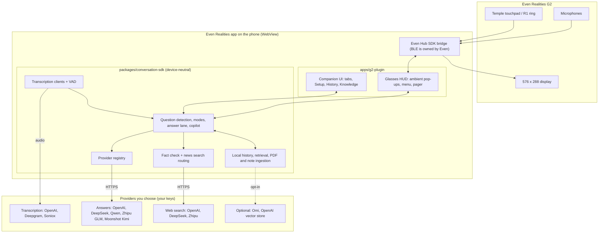

<p align="center"></p>

<h1 align="center">Helix G2</h1>

<p align="center"><b>A conversation copilot for Even Realities G2 smart glasses.</b><br>
It stays out of your sight until someone asks a question, then the answer appears on the lens.</p>

<p align="center">
<a href="https://github.com/FJiangArthur/Even-G2-Intelligence/actions/workflows/ci.yml"></a>
<a href="LICENSE"></a>


</p>

<p align="center"><b>English</b> | <a href="README.zh-CN.md">简体中文</a></p>

---

Helix is an open-source [Even Hub](https://hub.evenrealities.com/docs/get-started/overview) plugin. It listens to a conversation through the glasses' microphones and helps on the 576 × 288 green display: answers to questions people ask, short explanations of terms, lookups, and verdicts on claims worth checking. The phone shows the rest: transcript, summary, suggested questions, sources and history.

- **No Helix server.** The plugin runs inside the Even Realities phone app and calls the AI providers you choose, with your own API keys.
- **Your choice of provider.** OpenAI, DeepSeek, Qwen, Zhipu GLM or Moonshot Kimi for answers; OpenAI, Deepgram or Soniox for transcription.
- **A reusable core.** All orchestration lives in a device-neutral TypeScript SDK (`packages/conversation-sdk`); the G2 plugin is a thin adapter around it.

It is cloud AI called from the phone, not offline AI.

> Independent project. Not affiliated with or endorsed by Even Realities, OpenAI or any other provider named here.
>
> Recording people can require their consent. Check the law where you are and tell people you are using it.

## Contents

- [What you see on the glasses](#what-you-see-on-the-glasses)
- [Modes](#modes)
- [Providers](#providers)
- [News-backed fact checks](#news-backed-fact-checks)
- [Answer length](#answer-length)
- [Knowledge base and PDF import](#knowledge-base-and-pdf-import)
- [History](#history)
- [Keys, data and privacy](#keys-data-and-privacy)
- [Quick start](#quick-start)
- [Architecture](#architecture)
- [Status](#status)
- [Ideas for contributors](#ideas-for-contributors)
- [Documentation](#documentation)

## What you see on the glasses

**Nothing, most of the time.** Since 0.13 the default display is *ambient*: during a conversation the lens is blank. No caption, no clock, no images.

| Moment | On the glasses |
|---|---|
| Someone asks a question, or you ask for an answer | The question and answer pop up (`THEY ASKED`, `ANSWER`, `ANSWER KEY`). Long answers turn their own pages. The pop-up disappears 8 seconds after the answer is finished. |
| A cue arrives: a concept, a finished lookup, a conflict, a check verdict, a to-do change in Notes mode | A short card titled `CONCEPT`, `LOOKUP`, `CHECK`, `FACT CHECK` or `TO-DO`, then blank again. |
| The microphone turns on or off | `● listening`, `○ paused` or `○ mic off` in the corner for 4 seconds. |
| You double-tap | The full HUD wakes with its menu open: Answer, Answer all, Verify, the views, Mode ▶, Pause/Resume, Stop, Close. |
| You double-tap on the menu, or make no gesture for 20 seconds | Blank again. |

An answer has the display first; up to three cues wait behind it. Suggested questions, summaries and pending lookups never pop up. They wait in the woken HUD and on the phone.

Gestures on the blank display: **tap** pages or closes a pop-up, or asks about the last few sentences when nothing is showing (a billed request); **swipe** pages a pop-up; **hold** is push-to-talk; **double-tap** wakes the HUD.

Prefer the HUD always visible? Phone → Setup → G2 controls → **Always show the glasses HUD**. The full details are in [docs/PIXEL_GESTURES.md](docs/PIXEL_GESTURES.md).

<p align="center"></p>
<p align="center"><sub>The full HUD (what a double-tap wakes, or what "always show" keeps on): start screen, views, menu and mode picker. Rendered by the project's QA harness, not photographed through a lens.</sub></p>

The phone companion screen mirrors the glasses and adds tabs for Answers, Concepts, Summary, Q&A, Checks, People, History, Knowledge and Setup.

## Modes

A mode tells Helix what kind of conversation you are in. One tap (phone) or double-tap → Mode ▶ (glasses) changes how answers sound, what the background copilot looks for, and which features are on. The session keeps running.

| Mode | Pick it when | Answers questions automatically | Suggestions view | Deliberately left out |
|---|---|:-:|---|---|
| **Meeting** | Work conversations: decisions, owners, numbers | Yes | `ASK THEM` | Nothing |
| **Technical** | Engineering talks: specs, trade-offs | Yes | `PROBE` | Nothing |
| **Interviewer** | You run the interview | Yes, plus answer keys for your own questions | `PROBE` | Answering things people merely mention |
| **Partner** | Personal conversations | No | `CHECK IN` | Fact-checking, claims, conflicts, concept cards, web search |
| **Negotiation** | Offers, numbers and concessions | Yes | `ASK` | Deception or pressure tactics |
| **Learning** | Lectures and walkthroughs | Yes | `ASK` | Conflicts, claims, people tracking |
| **Social** | Casual talk | No | `TALK` | Conflicts, claims |
| **Quiet** | Captions and a running summary only (on the phone and in the woken HUD; the ambient display shows no caption) | No | `ASK THEM` | Suggestions, concept cards, anything proactive |
| **Notes** | You want action items, a to-do list and meeting notes | No | `ASK THEM` | Suggestions, concept cards, conflicts, claims |

- **Meeting** is the default, all-purpose mode: a direct answer first, then the decision, owner, risk or next step it implies.
- **Technical** keeps every feature on and tunes answers and follow-ups for engineering detail: specs, trade-offs, sharp probes.
- **Interviewer** is for the person asking the questions: it gives an answer key for your own questions, probes to ask next, and evidence on what the candidate said. It makes no comment on protected characteristics.
- **Partner** is for personal conversations: listen well and remember what matters. No fact-checking, no claims, no web search.
- **Negotiation** tracks offers, numbers and concessions and suggests questions that uncover interests.
- **Learning** explains concepts, keeps study notes and suggests smart questions during a lecture or walkthrough.
- **Social** offers easy follow-ups and quick lookups for casual talk, and does not answer on its own.
- **Quiet** only captions and summarises, on the phone and in the woken HUD. Ask when you want help.
- **Notes** is a note-taker: it captures action items with owner and due date into one to-do list that it edits instead of appending to, and writes short meeting notes. You can also edit the list by voice ("add a to-do to call the vendor by Friday", "mark the vendor call done", and basic Chinese forms such as 「添加待办 …」) or on the phone. The glasses show only a one-line `TODO + …` confirmation; the list is in the `TO-DO` view of the woken HUD, in the phone's Summary tab, and saved with the session in History and its Markdown export. It does not answer automatically.

There are nine modes in the picker. Every mode's system prompt is editable in Setup (up to 4,000 characters), and a preset is a starting point: you can flip any switch after choosing a mode. The full guide, with each preset table and the built-in prompts quoted verbatim, is [docs/MODES.md](docs/MODES.md) ([简体中文](docs/MODES.zh-CN.md)).

## Providers

Each key is sent only to its own provider's fixed URL. Every origin below is listed in the plugin's network whitelist (`apps/g2-plugin/app.json`).

**Answers and copilot** (Setup → Models → Answer provider)

| Provider | Profile | Models offered (first is the default) | Web search with sources |
|---|---|---|---|
| OpenAI | `openai-responses`, `openai-compatible` | OpenAI catalog | Yes, Responses `web_search` |
| DeepSeek | `deepseek` | `deepseek-flash`, `deepseek-v4-pro` | Yes, `deepseek_web_search` (beta, on `deepseek-flash`) |
| Alibaba Qwen, Beijing | `qwen` | `qwen3.7-plus`, `qwen3.8-flash`, `qwen4-max` | No |
| Alibaba Qwen, Singapore | `qwen-intl` | same as `qwen` | No |
| Zhipu GLM, bigmodel.cn | `zhipu` | `glm-5.2`, `glm-5.3`, `glm-5-turbo`, `glm-5`, `glm-4.7`, `glm-4.7-flash` | Yes, Zhipu Web Search API |
| Zhipu GLM, Z.ai | `zai` | `glm-5.2`, `glm-5.3`, `glm-5`, `glm-4.7` | None verified |
| Moonshot Kimi | `moonshot` | `kimi-k3.1-pro`, `kimi-k3` | No |

**Transcription** (Setup → Models → Transcription)

| Provider | Options |
|---|---|
| OpenAI | Realtime `gpt-live-transcribe`, `gpt-transcribe`, `gpt-4o-mini-transcribe`, `whisper-1` |
| Deepgram | `nova-3` |
| Soniox | `stt-rt-v5` |

Things to know before you pick a non-OpenAI answer provider:

- A session can run with no OpenAI key at all, for example DeepSeek for answers and Deepgram for transcription. OpenAI transcription, the OpenAI knowledge base, OpenAI PDF parsing and History → Generate summary still need an OpenAI key; Connect and Setup say exactly what is missing.
- Qwen and Zhipu keys are region-bound: choose the profile that matches where the key was created.
- Session cost is estimated only where list prices were verified (OpenAI and DeepSeek). Qwen, GLM and Kimi show "price n/a".
- Setup → API keys → **Test provider key** sends one tiny request to the selected provider.
- **The non-OpenAI providers were built from their public documentation and are covered by tests with mocked responses. No live request was made to DeepSeek, Qwen, Zhipu or Moonshot during development.** Reports from people with real keys are very welcome.

Per-provider request differences (thinking switches, token parameters, JSON mode) are in [docs/PROVIDERS_AND_SEARCH.md](docs/PROVIDERS_AND_SEARCH.md).

## News-backed fact checks

Fact checking is opt-in: turn on Knowledge → Memory → **Live web fact check** for automatic checks, or use **Verify** for a single claim.

- **Recent reporting first.** With Setup → Copilot → **Prefer latest news in fact checks** on (the default), the check carries today's date, and time-sensitive claims ("latest", "today", "just announced", 最新, 今天…) are searched news-first.
- **Dated sources.** Citations carry a publication date when one is known, and Helix records whether the date came from the search engine (DeepSeek, Zhipu) or was reported by the model for a page it really cited (OpenAI).
- **No source, no verdict.** A check without a real source is returned as "uncertain". Missing evidence is not proof that a claim is false. One difference on DeepSeek: when its answer carries no citation, the first three results of the search it ran are listed as the sources, so those pages were searched but not necessarily cited.
- **Where the search runs.** The answer provider's own search if it has a verified one; otherwise OpenAI web search if an OpenAI key is entered; otherwise nowhere, and Setup says "Web and news checks are off for this provider".
- **On the phone:** verdict, "latest news" and clickable source chips with site and date. "via *provider*" is shown when a non-OpenAI answer provider is selected (with OpenAI answers, the default, checks always run on OpenAI and carry no label).
- **On the glasses:** a `CHECK` / `FACT CHECK` pop-up; a news check ends with one line for its newest dated source, in the form `Src: site · date · +n`.

Searches cost money at the provider (per search, per token, or both).

## Answer length

Setup → How Helix should help → **Answer length**: Brief, Standard (default) or Detailed. One setting drives live answers, copilot lookups, check verdicts and concept explanations.

| | Brief | Standard | Detailed |
|---|---|---|---|
| Live answer | at most 2 sentences | your "Max answer sentences" setting (3 by default) | the limit is raised to at least 6 sentences |
| Copilot lookup | 2 sentences | 3 sentences | 5 sentences |
| Check verdict | one short sentence | one or two sentences | three or four sentences |
| Concept explanation | one short sentence | one or two sentences | two to four sentences |

Standard sends exactly the prompts and limits used before the setting existed. On the glasses, answers always page in full; with Detailed a cue may use up to 6 pages instead of 3.

## Knowledge base and PDF import

Helix can quote your own material in answers, with the source kept.

- **Local memory (default).** Past sessions, imported notes and PDFs are searched on the phone with bilingual (English and Chinese) keyword matching. No extra network request.
- **OpenAI knowledge base (opt-in).** Saved sessions are synced to a vector store in your own OpenAI project and searched per answer, with a fallback to the phone lookup.
- **Notes.** Import several Markdown or text files at once, paste text, or export your vault as Markdown.
- **Omi.** Import Omi conversations manually, or turn on automatic import (off by default; it runs while Helix is open).
- **PDFs.** Knowledge → Transfers → **PDF → Helix** takes up to 20 PDFs per batch (30 MB each), with a progress row per file and Cancel. Up to 400,000 characters of text are kept per PDF, and the parsed text shares the 5 MiB phone archive with all your saved sessions, so a batch of large PDFs may not all fit: a PDF that does not fit is reported as failed, nothing of it is kept, and an earlier copy of the same file stays.

Two ways to read a PDF:

| | On this phone | With OpenAI |
|---|---|---|
| Upload | None | Each PDF goes to your OpenAI project and is deleted again after parsing |
| Cost | None | Billed to your OpenAI key |
| Scanned PDFs | Not readable (no OCR) | Readable: the model sees the page images |
| Limits | Text layer only, first 500 pages, columns and tables can come out mixed | Long documents can be cut at the model's output limit |
| By link | No | Yes: OpenAI downloads the link, so no file picker is needed |

The on-phone parser is [pdf.js](https://mozilla.github.io/pdf.js/), loaded only when the first PDF is parsed.

**A known limit of the host app:** the Even Hub bridge has no file picker and no file-save API. Whether the Even app's WebView opens a file picker or a share sheet has not been verified on a phone, so every transfer has a fallback (paste text, add a PDF by link, copy to clipboard, show Markdown in the page) and tells you which one happened. Details: [docs/MEMORY_GUIDE.md](docs/MEMORY_GUIDE.md).

## History

The History tab is the record of your conversations. Everything in it is stored on the phone.

- **A summary after each conversation.** When a session ends, Helix makes one model call over the transcript and saves a short title, a one-to-two sentence overview, summary bullets and key facts, together with which model and prompt version wrote them and when. This call uses your OpenAI key. Without one, with almost nothing said, or if the call fails, the session gets a title made on the phone from what was said (for example "About Orin, Jetson") and you can tap **Generate summary** in the session later.
- **Only real conversations are kept.** Connecting does not create a session: the record appears with the first saved line, summary item, to-do or note. Empty records left by earlier versions are removed at startup. If the app is interrupted and you tap to resume within 30 minutes, the conversation continues as the same session, including its to-do list.
- **Cards.** Sessions are grouped by day (Today, Yesterday, then dates). A card shows the title, the time and duration, the overview, and labelled counts such as "10 speaker turns · 2 Helix answers · 3 to-dos (2 open)". PDFs you added to the knowledge base are listed last under **Documents**, not among the conversations. Open a card for the summary, to-dos and notes, AI cues, transcript and mindmap, and to export it as Markdown.
- **Removing sessions.** Open a session and tap **Remove**, or tap **Select**, tick several and remove them together. The confirmation is part of the page (no system dialog). Removal deletes the transcript, answers, summary, to-dos and notes from the phone and from local retrieval, and removes the session's file from your OpenAI knowledge base: at once when an OpenAI key is entered, otherwise at the next Sync.
- **"Let the knowledge base read history".** One switch decides whether answers may use what is saved. It is the same setting as Knowledge → "Use saved knowledge in answers" and covers everything saved on the phone: your conversations and what you imported (Omi, Obsidian notes, PDFs). On: for each answer, up to 5 short matching passages are sent to your answer provider with the question. Off: nothing saved is read for answers and Sync to OpenAI is refused; nothing is deleted, and files already synced stay in your OpenAI project until you delete them there (Knowledge → Delete from OpenAI).
- **One page, one scroll.** The companion page scrolls as a single page. The tab bar stays at the top and the Answers composer at the bottom; no panel has its own scroll area that could trap a drag.

## Keys, data and privacy

- **Keys are runtime input on the phone.** They are never read from build-time variables and never bundled into the package.
- **Held in memory by default.** "Save API keys on this phone" stores them in the Even app's plugin storage, which is ordinary local storage, not an encrypted vault.
- **One key, one destination.** Every key is sent only to its own provider's fixed URL. A DeepSeek, Qwen, Zhipu or Moonshot key joins a session only when that provider is selected for answers. An OpenAI key, once entered, is available to every session for the OpenAI-only features (web-search fallback, knowledge base, OpenAI transcription), and still goes only to OpenAI.
- **Where your conversation goes.** Audio goes to the transcription provider you select. Transcript text and questions go to the answer provider. Short candidate claims go to the search provider when fact checks are on. A PDF goes to OpenAI only if you choose the OpenAI parser.
- **What stays on the phone.** Saved sessions, notes and parsed PDF text, unless you export them, send them to Omi, or sync them to your own OpenAI vector store.
- **Diagnostics** contain lifecycle events, control names and timings. No keys, no transcripts.

Report security problems privately: see [SECURITY.md](SECURITY.md).

## Quick start

Requires Node.js 22+ and npm. No glasses needed for development: the official Even Hub simulator renders the display.

```bash
git clone https://github.com/FJiangArthur/Even-G2-Intelligence.git
cd Even-G2-Intelligence
npm install

npm run dev:plugin                      # Vite dev server on :5173
npx evenhub-simulator http://localhost:5173 --automation-port 9898   # in another terminal

npm run check                           # build all workspaces + run every test
bash scripts/run_gate.sh                # the same, plus the secret scan CI runs
npm run pack:g2                         # apps/g2-plugin/helix-g2.ehpk
```

In the app: Setup → enter a key for your answer and transcription providers → Connect → Listen. Setup → Rehearsal plays a scripted conversation through the live pipeline, so you can try it without speaking.

To run it on glasses, upload the `.ehpk` as a private build in the Even Hub developer portal and install it from the Even Realities app (see [docs/G2_DEPLOYMENT.md](docs/G2_DEPLOYMENT.md)).

## Architecture



| Path | What it is |
|---|---|
| `packages/conversation-sdk` | Device-neutral orchestration: provider calls, realtime transcription, question detection, modes, copilot, fact checks, local history and retrieval, PDF ingestion, typed events |
| `apps/g2-plugin` | The Even Hub plugin: glasses HUD, gestures, audio, phone companion UI, diagnostics |
| `services/gateway` | Legacy gateway kept for protocol regression tests; the plugin does not need it |
| `docs` | Guides, architecture, deployment, protocol, QA reports and research notes |

The SDK knows nothing about G2. A port to another display would write a new adapter beside `apps/g2-plugin` and reuse the rest. Project boundaries are in [AGENTS.md](AGENTS.md), which is also useful for humans.

## Status

**Pre-1.0 and under active development. Expect breaking changes.**

What is verified, and how:

- **Unit and integration tests** for all three workspaces, with fake providers and a fake bridge: no network, no keys. CI runs them on every pull request.
- **Even Hub simulator** for the glasses display, including a smoke run of the ambient display.
- **Desktop browser** with a fake bridge for the knowledge import and export flows.

What is not verified yet:

- **Real G2 hardware for 0.13.** The ambient display, pop-up readability without the frame, gesture delivery from the blank page and the wake/hide page swap have not been accepted on glasses. Simulator success is not hardware acceptance, and earlier releases had open issues on real glasses (see [CHANGELOG.md](CHANGELOG.md) for what was measured where).
- **Live calls to DeepSeek, Qwen, Zhipu and Moonshot**, and whether the Even app's WebView reaches their origins (whitelist, CORS, streaming).
- **File picker, share sheet and clipboard** inside the Even app's WebView, and pdf.js on a phone.
- **Live OpenAI PDF parsing and Omi automatic import** with real accounts.
- **Notes mode with a live model.** The prompts that capture to-dos and notes were tested with mocked replies only. Spoken to-do commands are pattern matches on the transcript: a transcription error can hide a command, and an ordinary sentence that starts like one can change the list.
- **The end-of-session summary with a live model**, and the History page (cards, in-page confirmation, one-page scrolling) inside the Even app's WebView.

The phone UI is English only. Conversations, search and retrieval work in English and Chinese.

## Ideas for contributors

This is a small project and there is real, well-scoped work open. None of the items below is a promise or a schedule; they are places where help would matter. Open a short [issue](https://github.com/FJiangArthur/Even-G2-Intelligence/issues) before a large change.

**Good first contributions**

- **Report from real hardware.** Run a build on G2 and tell us what happens against the device-only gates in [docs/PIXEL_GESTURES.md](docs/PIXEL_GESTURES.md) and [docs/MEMORY_GUIDE.md](docs/MEMORY_GUIDE.md). A clear report is a real contribution.
- **Try a provider with a real key.** DeepSeek, Qwen, Zhipu or Moonshot: does the key test pass, do answers stream, are the usage numbers right? See the unverified list in [docs/PROVIDERS_AND_SEARCH.md](docs/PROVIDERS_AND_SEARCH.md).
- **Fill in list prices** for Qwen, GLM and Kimi in the provider registry, with a link to the source.
- **Refresh older docs.** [docs/ARCHITECTURE.md](docs/ARCHITECTURE.md) and [docs/G2_DEPLOYMENT.md](docs/G2_DEPLOYMENT.md) were written for much earlier versions.
- **Improve a mode prompt** and explain what got better in a real conversation.

**Larger pieces**

- **Localise the phone UI** (it is English only; Simplified Chinese is the obvious first language).
- **More providers.** Doubao and SiliconFlow were left out because their parameters could not be verified from documentation; the mainland Moonshot host is not included either.
- **OCR for the on-phone PDF parser**, so scanned PDFs do not need an upload.
- **DOM tests for the Setup screen.** The plugin's tests run in a Node environment, so the provider and model picker rebuild is only tested through its pure helpers, and the 0.13 Setup controls (answer length, news search, the provider key fields, the always-on switch) are checked by markup and config round-trip tests, not by driving the form in a DOM (jsdom or happy-dom).
- **A second device adapter** on top of `packages/conversation-sdk`.

Read [CONTRIBUTING.md](CONTRIBUTING.md) first. `main` is protected, so changes land through pull requests that pass the gate. Say what you verified and where: unit test, simulator, or real glasses.

## Documentation

| Guide | What it covers |
|---|---|
| [docs/MODES.md](docs/MODES.md) · [中文](docs/MODES.zh-CN.md) | Every mode: presets, what it shows, built-in prompts, customising |
| [docs/PIXEL_GESTURES.md](docs/PIXEL_GESTURES.md) | Ambient display, pop-ups, gestures, the woken HUD |
| [docs/PROVIDERS_AND_SEARCH.md](docs/PROVIDERS_AND_SEARCH.md) | Answer providers, news-backed checks, answer length |
| [docs/MEMORY_GUIDE.md](docs/MEMORY_GUIDE.md) | History, Omi, notes, PDFs, local memory |
| [docs/G2_DEPLOYMENT.md](docs/G2_DEPLOYMENT.md) | Packaging and installing a private build |
| [docs/ARCHITECTURE.md](docs/ARCHITECTURE.md) | The phone-only design and its safety rules |
| [CHANGELOG.md](CHANGELOG.md) | Release notes, with where each measurement came from |

## License

[MIT](LICENSE). The Even Hub SDK, CLI and simulator are separate packages from Even Realities under their own terms.
