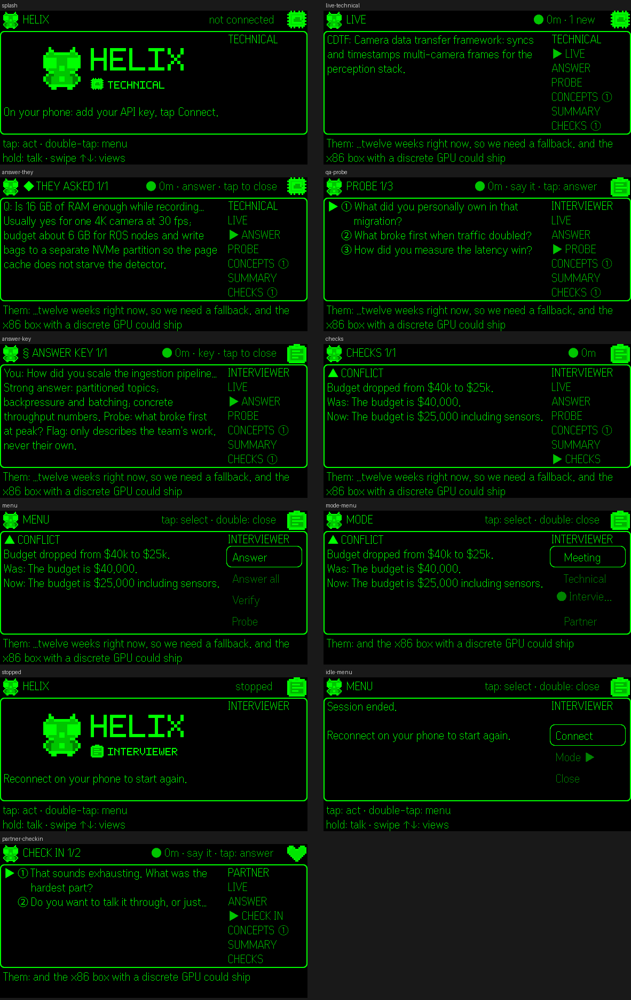

<p align="center"></p>

# Helix G2 — conversation intelligence for Even Realities G2

[](https://github.com/FJiangArthur/Even-G2-Intelligence/actions/workflows/ci.yml)
[](LICENSE)

Helix is an [Even Hub](https://hub.evenrealities.com/docs/get-started/overview) plugin for Even Realities G2 smart glasses. It listens to a conversation through the glasses' microphones and shows live help on the 576 × 288 green display: answers to questions people ask, short explanations of terms, a running summary, claims worth checking and questions worth asking.

It runs entirely in the Even Realities phone app. **There is no Helix server**: the phone talks directly to the AI providers you choose, with your own API keys. It is not offline AI.

> Independent project. Not affiliated with or endorsed by Even Realities or OpenAI.

<p align="center"></p>

## What it does

- **Live captions and answers** on the glasses, with a phone companion screen that mirrors the glasses display.
- **Modes** (Meeting, Technical, Interviewer, Partner, Negotiation, Learning, Social, Quiet), each with an editable system prompt.
- **Copilot views**: Answer, Ask, Concepts, Summary, Checks. Switch with a swipe; the menu is a double-tap.
- **History** per session: summary, AI cues, transcript, mindmap; Markdown export; Omi and Obsidian import/export.
- **Knowledge base for answers**: keyword search on the phone (default), or an opt-in OpenAI vector store synced from your saved sessions.
- **Diagnostics** that survive a relaunch (stalls, slow glasses writes, last controls used), with no keys or transcripts in the log.

## Status

Pre-1.0 and under active development. It is tested with unit and integration tests and in the official Even Hub simulator; behaviour on real glasses still has open issues (see [CHANGELOG.md](CHANGELOG.md) for what was measured where). Expect breaking changes.

## Quick start

Requires Node.js 22+ and npm.

```bash
npm install
npm run dev:plugin                      # Vite dev server on :5173
npx evenhub-simulator http://localhost:5173 --automation-port 9898   # in another terminal

bash scripts/run_gate.sh                # build + all tests + secret scan
npm run pack:g2                         # apps/g2-plugin/helix-g2.ehpk
```

To run it on glasses, upload the `.ehpk` as a private build in the Even Hub developer portal and install it from the Even Realities app (see [docs/G2_DEPLOYMENT.md](docs/G2_DEPLOYMENT.md)). In the app: Setup → enter your OpenAI key → Connect → Listen.

## Keys, data and privacy

- API keys are entered on the phone at runtime. They are held in memory by default; "save on phone" stores them in the Even app's plugin storage, which is not an encrypted vault.
- Keys are never read from build-time environment variables and are never bundled into the package. Each key is sent only to its own provider.
- Audio goes from the phone to the transcription provider you select; transcripts and answers go to the answer provider. Saved sessions stay on the phone unless you export them, send them to Omi, or sync them to your own OpenAI vector store.
- Recording people can require their consent. Check the law where you are and tell people you are using it.

Report security problems privately: see [SECURITY.md](SECURITY.md).

## Repository layout

| Path | What it is |
|---|---|
| `packages/conversation-sdk` | Device-neutral orchestration: provider calls, realtime transcription, question detection, copilot, local history and retrieval, typed events |
| `apps/g2-plugin` | The Even Hub plugin: glasses HUD, gestures, audio, phone companion UI, diagnostics |
| `services/gateway` | Legacy gateway kept for protocol regression tests; the plugin does not need it |
| `docs` | Architecture, deployment, protocol, QA reports and research notes |

Start with [docs/ARCHITECTURE.md](docs/ARCHITECTURE.md) and [AGENTS.md](AGENTS.md) (project boundaries, also useful for humans).

## Contributing

Issues and pull requests are welcome. Read [CONTRIBUTING.md](CONTRIBUTING.md) first; `main` is protected, so changes land through pull requests that pass the gate.

## License

[MIT](LICENSE). The Even Hub SDK, CLI and simulator are separate packages from Even Realities under their own terms.
