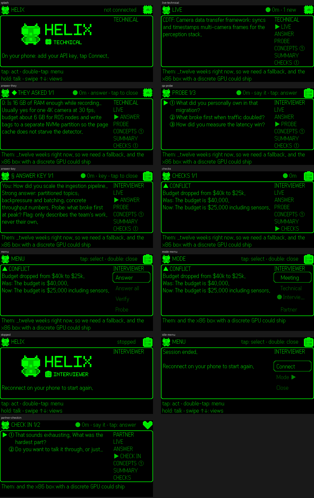
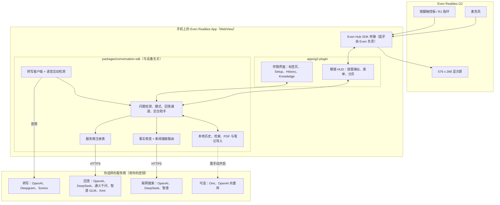

<p align="center"></p>

<h1 align="center">Helix G2</h1>

<p align="center"><b>为 Even Realities G2 智能眼镜打造的对话助手。</b><br>
平时不打扰视线，有人提问时，答案才出现在镜片上。</p>

<p align="center">
<a href="https://github.com/FJiangArthur/Even-G2-Intelligence/actions/workflows/ci.yml"></a>
<a href="LICENSE"></a>


</p>

<p align="center"><a href="README.md">English</a> | <b>简体中文</b></p>

---

Helix 是一个开源的 [Even Hub](https://hub.evenrealities.com/docs/get-started/overview) 插件。它通过眼镜的麦克风听对话，并在 576 × 288 的绿色显示屏上提供帮助：回答别人提出的问题、简短解释术语、查资料、对值得核实的说法给出结论。其余内容显示在手机上：转写、摘要、建议提问、来源和历史记录。

- **没有 Helix 服务器。** 插件运行在 Even Realities 手机 App 里，用你自己的 API Key 直接调用你选择的 AI 服务商。
- **服务商由你选。** 回答可用 OpenAI、DeepSeek、通义千问（Qwen）、智谱 GLM 或月之暗面 Kimi；语音转写可用 OpenAI、Deepgram 或 Soniox。
- **核心可复用。** 所有编排逻辑都在一个与设备无关的 TypeScript SDK（`packages/conversation-sdk`）里，G2 插件只是包在外面的一层适配。

它是从手机调用的云端 AI，不是离线 AI。

> 独立项目，与 Even Realities、OpenAI 以及文中提到的任何服务商均无隶属或背书关系。
>
> 录下他人的谈话可能需要对方同意。请先了解所在地的法律，并告知对方你正在使用它。

> 说明：手机端界面目前只有英文，所以下文的界面名称保留英文原文，括号里是中文解释。

## 目录

- [眼镜上能看到什么](#眼镜上能看到什么)
- [模式](#模式)
- [服务商](#服务商)
- [基于新闻的事实核查](#基于新闻的事实核查)
- [回答长度](#回答长度)
- [知识库与 PDF 导入](#知识库与-pdf-导入)
- [密钥、数据与隐私](#密钥数据与隐私)
- [快速开始](#快速开始)
- [架构](#架构)
- [当前状态](#当前状态)
- [可以参与的方向](#可以参与的方向)
- [文档](#文档)

## 眼镜上能看到什么

**大多数时候什么都没有。** 从 0.13 起，默认显示方式是 *ambient*（按需显示）：对话进行时镜片是空白的，没有字幕、时钟和图片。

| 时刻 | 眼镜上显示 |
|---|---|
| 有人提问，或你主动要答案 | 弹出问题和答案（`THEY ASKED`、`ANSWER`、`ANSWER KEY`）。长答案会自动翻页，答完 8 秒后消失。 |
| 来了一条提示：概念、查到的资料、前后矛盾、核查结论 | 一张短卡片，标题是 `CONCEPT`、`LOOKUP`、`CHECK` 或 `FACT CHECK`，随后恢复空白。 |
| 麦克风打开或关闭 | 角落显示 `● listening`、`○ paused` 或 `○ mic off`，持续 4 秒。 |
| 双击 | 唤出完整 HUD 并打开菜单：Answer、Answer all、Verify、各个视图、Mode ▶、Pause/Resume、Stop、Close。 |
| 在菜单上再双击，或 20 秒没有任何手势 | 恢复空白。 |

答案优先占用显示；最多三条提示在后面排队。建议提问、摘要和尚未完成的查询不会弹出，它们留在唤出的 HUD 和手机上。

空白状态下的手势：**单击**翻页或关闭弹出内容，没有内容时则就最近几句对话提问（这是一次计费请求）；**滑动**翻页；**长按**是按住说话；**双击**唤出 HUD。

想让 HUD 一直显示？在手机上进入 Setup → G2 controls → **Always show the glasses HUD**。完整说明见 [docs/PIXEL_GESTURES.md](docs/PIXEL_GESTURES.md)（英文）。

<p align="center"></p>
<p align="center"><sub>完整 HUD（双击唤出的画面，或开启“始终显示”后的画面）：启动画面、各视图、菜单和模式选择。图片由项目的 QA 工具渲染，不是透过镜片拍摄的。</sub></p>

手机端的伴随界面会镜像眼镜画面，并提供 Answers、Concepts、Summary、Q&A、Checks、People、History、Knowledge 和 Setup 这些标签页。

## 模式

模式告诉 Helix 你正处在哪种对话里。在手机上点一下，或在眼镜上双击 → Mode ▶，就会同时改变回答的语气、后台助手关注的内容，以及哪些功能开启。会话不会中断。

| 模式 | 适用场景 | 自动回答问题 | 建议视图的名称 | 刻意不做的事 |
|---|---|:-:|---|---|
| **Meeting**（会议） | 工作对话：决定、负责人、数字 | 是 | `ASK THEM` | 无 |
| **Technical**（技术） | 工程讨论：规格、取舍 | 是 | `PROBE` | 无 |
| **Interviewer**（面试官） | 由你主持面试 | 是，并为你自己的提问给出参考答案 | `PROBE` | 回答别人只是顺口提到的事 |
| **Partner**（伴侣） | 私人谈话 | 否 | `CHECK IN` | 事实核查、待核实说法、矛盾提示、概念卡片、联网搜索 |
| **Negotiation**（谈判） | 报价、数字和让步 | 是 | `ASK` | 欺骗或施压的手段 |
| **Learning**（学习） | 讲座和讲解 | 是 | `ASK` | 矛盾提示、待核实说法、人物追踪 |
| **Social**（社交） | 闲聊 | 否 | `TALK` | 矛盾提示、待核实说法 |
| **Quiet**（安静） | 只要字幕和滚动摘要（显示在手机上和唤出的 HUD 里；按需显示下镜片上没有字幕） | 否 | `ASK THEM` | 建议提问、概念卡片以及一切主动提示 |

- **Meeting** 是默认的通用模式：先给直接的答案，再指出它意味着的决定、负责人、风险或下一步。
- **Technical** 所有功能全开，回答和追问更偏向工程细节：规格、取舍、切中要害的问题。
- **Interviewer** 给提问的一方用：为你自己的问题提供参考答案，给出下一步可以追问的问题，并记录候选人说过的依据。它不会对受保护的个人特征作任何评论。
- **Partner** 用于私人谈话：好好倾听，记住重要的事。不做事实核查，不标记说法，也不联网搜索。
- **Negotiation** 跟踪报价、数字和让步，并建议能探出对方真实诉求的问题。
- **Learning** 在讲座或讲解中解释概念、整理学习笔记、建议值得问的问题。
- **Social** 为闲聊提供轻松的接话和快速查询，不会主动回答。
- **Quiet** 只做字幕和摘要（在手机上和唤出的 HUD 里），需要帮助时由你来问。

每个模式的系统提示词都可以在 Setup 里修改（最多 4,000 个字符）。预设只是起点：选好模式后，任何开关都还能再调。完整指南（含各模式的预设表和逐字引用的内置提示词）见 [docs/MODES.zh-CN.md](docs/MODES.zh-CN.md)（[English](docs/MODES.md)）。

## 服务商

每个密钥只会发往它所属服务商的固定地址。下面所有域名都列在插件的网络白名单里（`apps/g2-plugin/app.json`）。

**回答与后台助手**（Setup → Models → Answer provider）

| 服务商 | 配置 ID | 可选模型（第一个为默认） | 带来源的联网搜索 |
|---|---|---|---|
| OpenAI | `openai-responses`、`openai-compatible` | OpenAI 模型目录 | 有，Responses `web_search` |
| DeepSeek | `deepseek` | `deepseek-flash`、`deepseek-v4-pro` | 有，`deepseek_web_search`（测试版，用于 `deepseek-flash`） |
| 阿里通义千问，北京 | `qwen` | `qwen3.7-plus`、`qwen3.8-flash`、`qwen4-max` | 无 |
| 阿里通义千问，新加坡 | `qwen-intl` | 同 `qwen` | 无 |
| 智谱 GLM，bigmodel.cn | `zhipu` | `glm-5.2`、`glm-5.3`、`glm-5-turbo`、`glm-5`、`glm-4.7`、`glm-4.7-flash` | 有，智谱 Web Search API |
| 智谱 GLM，Z.ai | `zai` | `glm-5.2`、`glm-5.3`、`glm-5`、`glm-4.7` | 未能确认 |
| 月之暗面 Kimi | `moonshot` | `kimi-k3.1-pro`、`kimi-k3` | 无 |

**语音转写**（Setup → Models → Transcription）

| 服务商 | 选项 |
|---|---|
| OpenAI | Realtime `gpt-live-transcribe`、`gpt-transcribe`、`gpt-4o-mini-transcribe`、`whisper-1` |
| Deepgram | `nova-3` |
| Soniox | `stt-rt-v5` |

选择非 OpenAI 的回答服务商之前，需要知道：

- 整个会话可以完全不用 OpenAI 的密钥，例如用 DeepSeek 回答、用 Deepgram 转写。但 OpenAI 转写、OpenAI 知识库、用 OpenAI 解析 PDF 以及 History → Generate summary 仍然需要 OpenAI 密钥；Connect 和 Setup 会明确告诉你缺的是哪一个。
- 通义千问和智谱的密钥与地区绑定：请选择与密钥创建地区一致的配置。
- 只有核实过官方价格的服务商（OpenAI 和 DeepSeek）才会估算会话费用。通义千问、GLM 和 Kimi 显示 "price n/a"。
- Setup → API keys → **Test provider key** 会向所选服务商发送一个很小的请求来测试密钥。
- **非 OpenAI 的服务商是依据各家公开文档实现的，测试用的都是模拟响应。开发过程中没有向 DeepSeek、通义千问、智谱或月之暗面发出过真实请求。** 非常欢迎手里有真实密钥的朋友反馈使用情况。

各服务商在请求上的差异（思考开关、token 参数、JSON 模式）见 [docs/PROVIDERS_AND_SEARCH.md](docs/PROVIDERS_AND_SEARCH.md)（英文）。

## 基于新闻的事实核查

事实核查需要手动开启：在 Knowledge → Memory 打开 **Live web fact check** 可自动核查，也可以用 **Verify** 核实单个说法。

- **优先看最新报道。** Setup → Copilot → **Prefer latest news in fact checks** 默认开启。开启后，核查请求会带上当天日期，而带时效性的说法（"latest"、"today"、"just announced"、最新、今天……）会优先搜索新闻。
- **来源带日期。** 引用在已知时会附上发布日期，Helix 还会记录这个日期是搜索引擎给出的（DeepSeek、智谱），还是模型针对它确实引用的页面报告的（OpenAI）。
- **没有来源就不下结论。** 没有真实来源的核查会返回 "uncertain"（不确定）。找不到证据并不等于这个说法是错的。DeepSeek 有一点不同：如果它的回答没有带引用，就把它所做搜索的前三条结果列为来源，这些页面被搜索到了，但不一定被引用。
- **搜索在哪里进行。** 回答服务商自带且已确认可用的搜索优先；否则，如果填了 OpenAI 密钥，就用 OpenAI 联网搜索；再否则就不搜索，Setup 会显示 "Web and news checks are off for this provider"。
- **手机上：** 显示结论、"latest news"，以及带网站名和日期、可点击的来源标签。只有选用非 OpenAI 的回答服务商时才显示 "via *服务商*"（默认用 OpenAI 回答时，核查总是走 OpenAI，不带这个标记）。
- **眼镜上：** 弹出 `CHECK` / `FACT CHECK`；新闻核查的末尾会有一行最新的带日期来源，格式为 `Src: 网站 · 日期 · +n`。

搜索会在服务商那里产生费用（按次、按 token，或两者都有）。

## 回答长度

Setup → How Helix should help → **Answer length**：Brief（简短）、Standard（标准，默认）或 Detailed（详细）。这一个设置同时作用于实时回答、后台查询、核查结论和概念解释。

| | Brief | Standard | Detailed |
|---|---|---|---|
| 实时回答 | 最多 2 句 | 按你的 "Max answer sentences" 设置（默认 3 句） | 句数上限提高到至少 6 句 |
| 后台查询 | 2 句 | 3 句 | 5 句 |
| 核查结论 | 一个短句 | 一到两句 | 三到四句 |
| 概念解释 | 一个短句 | 一到两句 | 两到四句 |

Standard 发送的提示词和限制与加入这个设置之前完全相同。在眼镜上，答案始终完整分页显示；选 Detailed 时，一条提示最多可占 6 页，而不是 3 页。

## 知识库与 PDF 导入

Helix 可以在回答里引用你自己的资料，并保留出处。

- **本地记忆（默认）。** 过去的会话、导入的笔记和 PDF 都在手机上做中英文关键词检索，不产生额外的网络请求。
- **OpenAI 知识库（需手动开启）。** 已保存的会话会同步到你自己 OpenAI 项目里的向量库，每次回答时检索；失败时退回手机上的检索。
- **笔记。** 可以一次导入多个 Markdown 或文本文件、直接粘贴文本，或把整个资料库导出为 Markdown。
- **Omi。** 可以手动导入 Omi 对话，也可以开启自动导入（默认关闭，只在 Helix 打开时运行）。
- **PDF。** Knowledge → Transfers → **PDF → Helix** 每批最多 20 个 PDF（每个不超过 30 MB），每个文件有自己的进度行，并可取消。每个 PDF 最多保留 400,000 个字符的文本；解析出的文本和所有已保存的会话共用手机上 5 MiB 的存档空间，所以一批大文件不一定都放得下：放不下的 PDF 会显示为失败，不会留下任何残缺内容，同一文件之前导入的版本也会保留。

PDF 有两种读取方式：

| | On this phone（在手机上） | With OpenAI（用 OpenAI） |
|---|---|---|
| 上传 | 不上传 | 每个 PDF 会上传到你的 OpenAI 项目，解析后即删除 |
| 费用 | 无 | 计入你的 OpenAI 密钥 |
| 扫描件 | 读不了（没有 OCR） | 可以：模型能看到页面图像 |
| 限制 | 只读文字层；只读前 500 页；多栏和表格的顺序可能错乱 | 长文档可能在模型的输出上限处被截断 |
| 通过链接添加 | 不支持 | 支持：由 OpenAI 去下载链接，不需要文件选择器 |

手机端的解析器是 [pdf.js](https://mozilla.github.io/pdf.js/)，只有在第一次解析 PDF 时才会加载。

**宿主 App 的一个已知限制：** Even Hub 的桥接接口没有文件选择器，也没有保存文件的 API。Even App 的 WebView 能否弹出文件选择器或分享面板，还没有在真机上验证过。所以每种传输都准备了后备方式（粘贴文本、通过链接添加 PDF、复制到剪贴板、在页面里显示 Markdown），并会告诉你实际走的是哪一种。详见 [docs/MEMORY_GUIDE.md](docs/MEMORY_GUIDE.md)（英文）。

## 密钥、数据与隐私

- **密钥是在手机上运行时输入的。** 它们不会从构建时的环境变量里读取，也不会被打进安装包。
- **默认只保存在内存里。** 勾选 "Save API keys on this phone" 后，密钥会存入 Even App 的插件存储。那是普通的本地存储，不是加密保险箱。
- **一个密钥，一个去处。** 每个密钥只发往它自己服务商的固定地址。DeepSeek、通义千问、智谱 GLM、月之暗面 Kimi 的密钥只有在选它来回答时才会加入会话。OpenAI 密钥一旦填写，每次会话都可用于只有 OpenAI 提供的功能（联网搜索后备、知识库、OpenAI 转写），同样只发往 OpenAI。
- **对话内容去了哪里。** 音频发往你选择的转写服务商；转写文本和问题发往回答服务商；开启事实核查后，简短的待核实说法会发往搜索服务商；只有选择用 OpenAI 解析时，PDF 才会发往 OpenAI。
- **哪些留在手机上。** 保存的会话、笔记和解析出的 PDF 文本都留在手机上，除非你导出它们、发送到 Omi，或同步到你自己的 OpenAI 向量库。
- **诊断日志** 只包含生命周期事件、控件名称和耗时，不含密钥和转写内容。

安全问题请私下报告，见 [SECURITY.md](SECURITY.md)。

## 快速开始

需要 Node.js 22+ 和 npm。开发时不需要眼镜：官方的 Even Hub 模拟器可以渲染显示画面。

```bash
git clone https://github.com/FJiangArthur/Even-G2-Intelligence.git
cd Even-G2-Intelligence
npm install

npm run dev:plugin                      # Vite 开发服务器，端口 5173
npx evenhub-simulator http://localhost:5173 --automation-port 9898   # 在另一个终端运行

npm run check                           # 构建全部工作区并运行所有测试
bash scripts/run_gate.sh                # 同上，再加上 CI 使用的密钥扫描
npm run pack:g2                         # 生成 apps/g2-plugin/helix-g2.ehpk
```

在 App 里：Setup → 填入回答服务商和转写服务商的密钥 → Connect → Listen。Setup → Rehearsal 可以把一段预设的对话送进真实的处理流程，不用开口也能试用。

要在眼镜上运行，请把 `.ehpk` 作为私有版本上传到 Even Hub 开发者平台，再从 Even Realities App 安装（见 [docs/G2_DEPLOYMENT.md](docs/G2_DEPLOYMENT.md)，英文）。

## 架构



| 路径 | 内容 |
|---|---|
| `packages/conversation-sdk` | 与设备无关的编排：调用服务商、实时转写、问题检测、模式、后台助手、事实核查、本地历史与检索、PDF 导入、类型化事件 |
| `apps/g2-plugin` | Even Hub 插件：眼镜 HUD、手势、音频、手机伴随界面、诊断 |
| `services/gateway` | 旧版网关，只为协议回归测试而保留；插件不需要它 |
| `docs` | 使用指南、架构、部署、协议、QA 报告和调研笔记 |

SDK 对 G2 一无所知。要移植到另一种显示设备，只需在 `apps/g2-plugin` 旁边再写一个适配层，其余部分可以直接复用。项目边界写在 [AGENTS.md](AGENTS.md) 里，对人同样有用。

## 当前状态

**尚未到 1.0，仍在积极开发中，随时可能有不兼容的改动。**

已经验证的部分，以及验证方式：

- 三个工作区都有**单元测试和集成测试**，使用模拟的服务商和模拟的桥接：不联网，不需要密钥。每个 Pull Request 都会在 CI 上运行这些测试。
- 眼镜显示在 **Even Hub 模拟器**里验证过，包括按需显示的冒烟测试。
- 知识库的导入和导出流程在**桌面浏览器**里用模拟桥接验证过。

尚未验证的部分：

- **0.13 在真实 G2 硬件上的表现。** 按需显示、没有边框时弹出内容是否清晰、空白页面上手势能否可靠送达、唤出和隐藏时的页面切换，都还没有在眼镜上验收。模拟器通过不等于硬件验收，而且此前的版本在真机上有未解决的问题（哪些数据是在哪里测得的，见 [CHANGELOG.md](CHANGELOG.md)）。
- **对 DeepSeek、通义千问、智谱和月之暗面的真实调用**，以及 Even App 的 WebView 能否访问它们的域名（白名单、跨域、流式传输）。
- Even App 的 WebView 里的**文件选择器、分享面板和剪贴板**，以及 pdf.js 在手机上的表现。
- 用真实账号进行的 **OpenAI PDF 解析和 Omi 自动导入**。

手机端界面只有英文。对话、搜索和检索支持英文和中文。

## 可以参与的方向

这是个小项目，有不少范围清楚、确实需要人做的事。下面列的都不是承诺或排期，只是帮得上忙的地方。动手做较大的改动之前，请先开一个简短的 [issue](https://github.com/FJiangArthur/Even-G2-Intelligence/issues)。

**适合入门的贡献**

- **真机反馈。** 在 G2 上跑一个版本，对照 [docs/PIXEL_GESTURES.md](docs/PIXEL_GESTURES.md) 和 [docs/MEMORY_GUIDE.md](docs/MEMORY_GUIDE.md) 里只能在真机上验证的项目，告诉我们实际情况。一份清楚的报告就是实实在在的贡献。
- **用真实密钥试一个服务商。** DeepSeek、通义千问、智谱或月之暗面：密钥测试能通过吗？回答能流式输出吗？用量数字对吗？未验证项见 [docs/PROVIDERS_AND_SEARCH.md](docs/PROVIDERS_AND_SEARCH.md)。
- **补全官方价格。** 在服务商注册表里补上通义千问、GLM 和 Kimi 的价格，并附上来源链接。
- **更新旧文档。** [docs/ARCHITECTURE.md](docs/ARCHITECTURE.md) 和 [docs/G2_DEPLOYMENT.md](docs/G2_DEPLOYMENT.md) 是为很早的版本写的。
- **改进某个模式的提示词**，并说明它在真实对话里好在哪里。

**较大的工作**

- **手机界面本地化**（目前只有英文，简体中文显然是第一个该做的语言）。
- **更多服务商。** 豆包和硅基流动（SiliconFlow）没有加入，因为它们的参数无法从文档中确认；月之暗面的中国大陆域名也还没有包含。
- **给手机端 PDF 解析器加上 OCR**，这样扫描件就不必上传。
- **Setup 页面的 DOM 测试。** 插件的测试运行在 Node 环境里，所以服务商和模型选择器的重建逻辑只通过纯函数得到了测试；0.13 新增的 Setup 控件（回答长度、新闻搜索、各服务商密钥输入框、始终显示开关）只验证了页面标记和配置的存取，没有在 DOM（jsdom 或 happy-dom）里实际操作表单。
- 在 `packages/conversation-sdk` 之上做**第二种设备的适配层**。

请先阅读 [CONTRIBUTING.md](CONTRIBUTING.md)（英文）。`main` 分支受保护，改动需要通过 Pull Request 合入，并通过 gate 检查。请说明你验证了什么、在哪里验证的：单元测试、模拟器，还是真实眼镜。

## 文档

| 文档 | 内容 |
|---|---|
| [docs/MODES.zh-CN.md](docs/MODES.zh-CN.md) · [English](docs/MODES.md) | 每个模式：预设、显示内容、内置提示词、如何自定义 |
| [docs/PIXEL_GESTURES.md](docs/PIXEL_GESTURES.md) | 按需显示、弹出内容、手势、唤出的 HUD（英文） |
| [docs/PROVIDERS_AND_SEARCH.md](docs/PROVIDERS_AND_SEARCH.md) | 回答服务商、基于新闻的核查、回答长度（英文） |
| [docs/MEMORY_GUIDE.md](docs/MEMORY_GUIDE.md) | 历史记录、Omi、笔记、PDF、本地记忆（英文） |
| [docs/G2_DEPLOYMENT.md](docs/G2_DEPLOYMENT.md) | 打包并安装私有版本（英文） |
| [docs/ARCHITECTURE.md](docs/ARCHITECTURE.md) | 纯手机端的设计及其安全规则（英文） |
| [CHANGELOG.md](CHANGELOG.md) | 版本说明，并注明每项数据的来源（英文） |

## 许可证

[MIT](LICENSE)。Even Hub SDK、CLI 和模拟器是 Even Realities 发布的独立软件包，各自适用其自己的条款。
