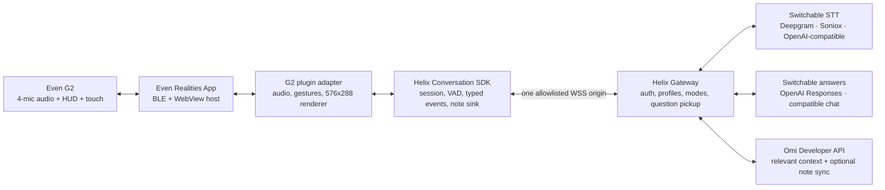
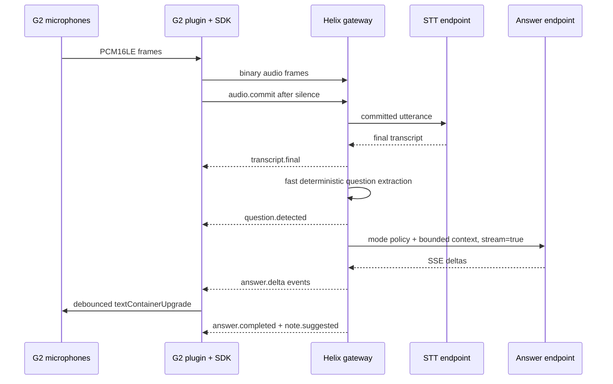

# Historical v0.3 gateway architecture

Superseded by the phone-only v0.4 architecture in ARCHITECTURE.md. Retained only to explain the legacy gateway regression suite.

## Architecture decision

Use a thin Even Hub plugin plus a reusable TypeScript conversation SDK and a self-hosted gateway.



This keeps three boundaries honest:

1. Even Realities owns BLE and hardware details.
2. Helix owns conversation behavior and semantic presentation.
3. The user owns model credentials and stored knowledge. Optional BYOK keys enter
   the companion only in masked fields, travel once over WSS, and are not built
   into the package or retained by the self-hosted server.

The browser/server boundary is versioned as protocol `2.1`, WebSocket subprotocol `helix.v2`, and route `/v2/conversations`. Protocol 2.1 adds a command-level, one-shot BYOK envelope while leaving accepted events and provenance credential-free.

## Components

### `packages/conversation-sdk`

Device-neutral TypeScript API consumed by the G2 plugin and any future wearable adapter.

Responsibilities:

- session lifecycle, normalized conversation mode and response strategy, and ordered turn identity;
- typed gateway commands and events;
- PCM16 16 kHz utterance segmentation;
- manual questions;
- independently selected STT and answer profile provenance, plus prompt, mode, trigger, speaker, and latency provenance;
- pluggable note sink;
- no Even SDK imports and no compiled provider secrets; transient credentials
  are a separate optional `start()` argument, never part of SessionConfig.

Reconnect/resume, cancellation, and fast/deep answer roles remain planned extensions rather than current claims.

Public shape:

```ts
const transport = new WebSocketConversationTransport({
  url: 'wss://helix.example.com/v2/conversations',
  protocols: helixWebSocketProtocols(shortLivedToken),
})
const client = new HelixConversationClient(transport, { vad, noteSink })

await client.start({
  sessionId: 'session_01',
  endpoint: {
    id: 'my-endpoint',
    url: 'wss://helix.example.com/v2/conversations',
    provider: 'openai-compatible',
    model: 'my-model',
  },
  prompt: {
    id: 'sales-coach',
    version: '1',
    system: 'Answer with one direct, speakable suggestion.',
    mode: 'general',
    maxResponseSentences: 3,
  },
  speaker: { label: 'G2 conversation', role: 'unknown' },
  mode: 'office-discussion',
  responseStrategy: 'both',
  providers: {
    transcriptionProvider: 'deepgram',
    answerProvider: 'openai-responses',
  },
  memory: {
    readOmiContext: true,
    syncNotes: true,
  },
  automation: {
    detectQuestions: true,
    answerQuestions: true,
    saveNotes: true,
  },
})

await client.sendAudio(pcm16Samples, {
  source: 'glasses',
  speakerRole: 'other',
})
await client.ask('What should I clarify next?')
client.subscribe(event => render(event))
```

### `apps/g2-plugin`

The only package that imports `@evenrealities/even_hub_sdk`.

Responsibilities:

- await the injected bridge;
- create the G2 startup page before opening the G2 microphone;
- translate G2/R1 gestures into semantic controls;
- pass G2 PCM to the Helix SDK;
- render attributed transcript, question, answer and note status;
- expose bounded mode, response-strategy, STT, answer and Omi controls plus
  visible masked OpenAI, Deepgram, Soniox, and Omi BYOK inputs;
- represent the default STT/answer choice as a UI-only **Gateway default** sentinel and omit that preference from `session.providers`;
- debounce frequent text updates by at least 120 ms;
- keep the gateway access token in memory only;
- persist provider keys only in a dedicated, explicit opt-in Even local-storage
  record with a visible clear action; do not claim Keychain/secure-enclave protection;
- expose an explicit cold-start boundary for future WebView recovery work.

It must not know provider request JSON, upstream endpoints/auth layouts, raw BLE bytes, or note filtering rules.

### `services/gateway`

The security and interoperability boundary.

Responsibilities:

- authenticate the plugin’s operator-configured access token in Phase 0, with short-lived token issuance planned for pairing;
- accept G2 PCM frames and turn commits;
- resolve client choices only against server-configured and allowlisted provider profiles;
- transcribe with mock, OpenAI-compatible, Deepgram prerecorded, or Soniox real-time WebSocket adapters; forward G2 frames live to Soniox and pace the buffered fallback as 3,840-byte chunks at 120 ms intervals;
- detect up to three questions in source order;
- stream answer deltas from the configured model;
- answer with mock, OpenAI Responses, or OpenAI-compatible streaming adapters;
- apply versioned mode and proactive/reactive prompt policy;
- emit typed errors and latency diagnostics;
- fetch a bounded recent Omi set, select relevant context locally, and keep that fetch off the critical answer path after a short deadline;
- propose safe notes and, only when opted in and enabled server-side, report Omi writes as pending, synced, or failed;
- support separate endpoint roles when one provider cannot do all tasks.

Provider and Omi keys come from the session BYOK envelope first or server
environment fallback second. The server resolves only allowlisted metadata and
constructs immutable provider/Omi clients for that session; it never mutates
shared profiles or writes a submitted key. Provider-specific codecs remain
direct server adapters rather than client networking branches. Multi-user
profile ownership, pairing, and account-scoped authorization remain later work.

## Prompt architecture

Prompts have three explicit layers:

1. **Helix policy**: versioned safety, direct-output and provenance requirements controlled by the gateway owner.
2. **User profile**: user-owned role, preferred style, vocabulary and response length.
3. **Turn context**: transcript, detected question or proactive trigger, recent turns, bounded relevant Omi context and requested depth.

Every response event records:

- separate transcription and answer profile/model selections;
- prompt profile ID and version;
- session, question and answer IDs;
- event time, first-delta and completion latency;

The current event records the selected profiles, model, prompt reference, mode, response strategy, trigger, speaker hints, and latency breakdown. Fast/deep role selection and generation cancellation remain later additions.

This corrects a current Helix limitation where provider identity is a closed enum and custom instructions are appended to a private fixed prompt without full provenance.

## Question pickup path



The deterministic detector commits explicit multilingual questions without a classifier round trip. Provisional partial-transcript detection and an optional classifier endpoint remain later work.

## Intelligent notes

Automatic capture runs from committed semantic outcomes, not from a mounted UI view.

A note proposal is eligible only when:

- the provider answer is complete and passes deterministic capture checks;
- it contains at least one conservative useful-memory signal: a decision/commitment, action/follow-up/deadline, requirement/preference/risk/blocker/priority, or explicit personal/team/project plan or obligation;
- it is not a question or canned/error/uncertain text;
- it contains no credential, token, JWT or other sensitive pattern;
- it is not a duplicate of a recent note;
- it carries source and prompt provenance.

The plugin uses a bounded in-memory sink for a truthful per-session capture state. When Omi sync is explicitly selected and the gateway has both a key and write enablement, the gateway writes the safe answer through the Omi Developer API and emits a pending result followed by synced or failed. No result is labeled synced before the remote response. G2 local storage contains settings only; it is not the note system of record.

## Mapping from current Helix

| Current native source | Portable behavior | G2 treatment |
|---|---|---|
| `NativeHelix/Sources/HelixCore/HelixDomain.swift` | modes, turns, speaker metadata, prompt/answer models, latency | mirror as TypeScript contracts and golden fixtures |
| `NativeHelix/Sources/HelixAI/AnswerProvider.swift` | injectable answer stream | generalize to an open endpoint identity and real network deltas |
| `NativeHelix/Sources/HelixSpeech` | transcript events, normalization, question inputs | preserve semantics; source audio comes from G2 SDK |
| `NativeHelix/Sources/HelixConversation/QuestionClassifier.swift` | fast rules plus optional model fallback | port and benchmark against shared fixtures |
| `NativeHelix/Sources/HelixConversation/ConversationEngine.swift` | ordering, multi-question limits, failure isolation, context | port after removing `G1HudPage` from public output |
| `NativeHelix/Sources/HelixRuntime/KnowledgeSessionState.swift` | safe capture, dedupe, undo | move behind device-neutral policy and sink contracts |
| `NativeHelix/Sources/HelixG1` | BLE, ACK, raw HUD protocol | do not port; Even Hub replaces it |

The existing Swift package currently exposes G1 presentation types from `HelixConversation` and owns G1 state in `HelixRuntime`. Those dependencies should be removed in the native repo as a separate, versioned refactor. This new workspace must not copy the live dirty checkout or ship local debug archives.

## Target recovery model

- Persist non-secret session settings and last committed turn eagerly.
- Treat Android foreground resume as a cold start.
- Recreate the Even bridge page, reconnect the gateway socket, and re-enable the same microphone source.
- Never assume a WebSocket or `audioControl(true)` survived suspension.
- Do not perform model calls while backgrounded.
- De-duplicate retransmitted turn and note IDs on the gateway.

These are acceptance requirements for the recovery phase. The Phase 0 client does not yet reconnect, replay, or resume a session.

## Deliberate non-goals for the first release

- direct BLE access;
- arbitrary pixel/video rendering;
- background push or always-on capture;
- API keys or arbitrary upstream URLs in the `.ehpk`;
- automatic writing into Apple Notes through the public G2 SDK;
- claiming simulator timing as hardware timing.
